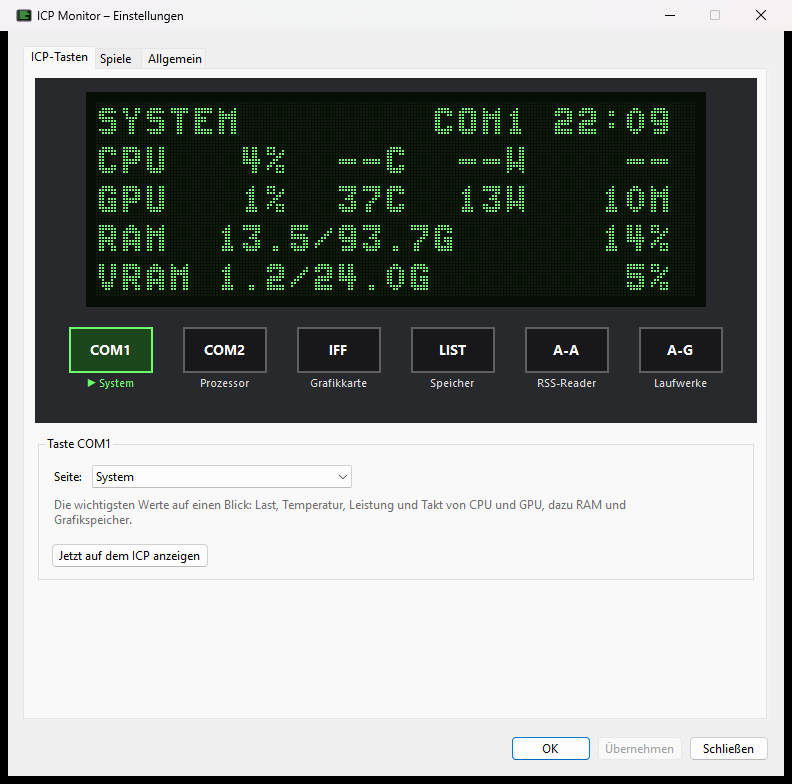
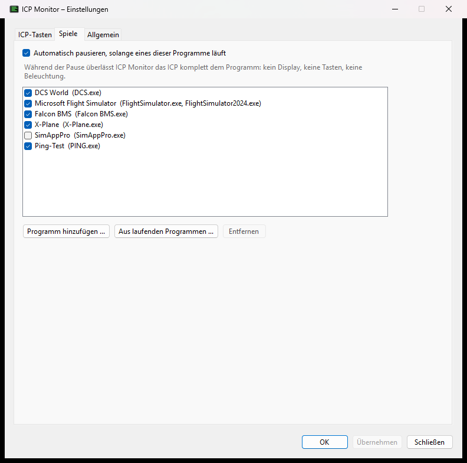

# ICP Monitor

Shows PC sensor values on the DED display of a Winwing/WinCTRL F-16 ICP. Runs in the Windows system
tray and is operated with the ICP's own buttons and knobs. The app itself speaks English and German.



> ICP Monitor is an independent hobby project and is not affiliated with or endorsed by Winwing.

## Features

- Six freely assignable pages on `COM1`, `COM2`, `IFF`, `LIST`, `A-A`, `A-G`: system, processor,
  graphics card, memory, drives, network, clock, RSS reader
- Original DED pixel font, settings window with a pixel-exact preview of the display
- Display and button brightness via the `SYM` and `BRT` knobs
- Automatic pause while DCS World, MSFS, Falcon BMS, X-Plane or programs you add are running
- Autostart with administrator rights without a UAC prompt, auto-update with checksum verification
- English and German, following the Windows language by default

## Installation

Download `ICP-Monitor-Setup-<version>.exe` from the
[releases](https://github.com/The-Real-G-Evil/icp-monitor/releases/latest) and run it. The installer
bundles the .NET runtime, installs to `C:\Program Files\ICP Monitor`, adds a Start menu entry and
optionally sets up autostart. A running instance is closed automatically during updates.

The installer is not code-signed, so Windows SmartScreen may warn on first run
("More info" > "Run anyway").

**Autostart** uses the Windows Task Scheduler (task "ICP Monitor"): the app starts at logon with
administrator rights and without a UAC prompt. Toggle it in the tray menu under "Start with Windows".
For security reasons this is only possible for the installed version under "Program Files".

With administrator rights the app additionally reads CPU temperature, CPU power, clock speed,
mainboard fans and disk temperatures. Without autostart: tray menu > "Restart as administrator".

Settings, log and sensor list are stored in `%AppData%\ICP Monitor` and are kept across updates and
uninstallation.

## Usage

Tray icon: left click = next page, double click = settings, right click = menu.

| ICP | Function |
| --- | --- |
| `COM1` `COM2` `IFF` `LIST` `A-A` `A-G` | Show the page assigned to this button |
| Dobber up/down | Scroll within a page (RSS, drives), otherwise previous/next page |
| `ENTR` on the RSS page | Open the article in the browser |
| `0`–`9` | Action from `config.json` (`actions`) |
| `WARN RESET` | Display off; any button turns it back on |
| Knob `SYM` | Display brightness |
| Knob `BRT` | Button LED brightness |
| `UP` `DOWN` `SEQ` `RTN`, knobs `CONT` `RET DEPR` | No function |

Which page sits on which button is set in the settings window. It replicates the six buttons and shows
a pixel-exact preview of the DED. The language and the ICP test page are also found there.

Page types: system, processor, graphics card, memory, drives, network, clock, RSS reader.
The RSS reader reads RSS 2.0, RSS 1.0 and Atom, merges several feeds by date and reloads every 10 minutes.

## Flight simulator pause

While a simulator is running, ICP Monitor leaves the ICP entirely to the simulator or SimAppPro: the DED
shows "DCS WORLD STARTED. ICP MONITOR IS PAUSED." for three seconds and then goes blank; buttons, knobs
and lighting are no longer touched. A few seconds after the simulator exits, the app continues
automatically.

Detected out of the box: DCS World, Microsoft Flight Simulator 2020/2024, Falcon BMS and X-Plane.
SimAppPro is in the list but off by default, because it often runs permanently in the background.
More programs can be added in the settings window ("Games" tab), either by picking the exe file or from
the currently running programs. The tray menu also offers a manual "Pause".



## Updates

The app checks GitHub for a newer version at startup and every six hours and shows a notification at
the tray icon. After confirmation it downloads the installer, verifies it against the SHA-256 checksum
published with the release and installs it without further prompts; the new version starts afterwards.
Nothing is installed without a matching checksum. Can be turned off in the settings window ("General" tab).

A release therefore needs both files from `artifacts`: `ICP-Monitor-Setup-<version>.exe` and
`ICP-Monitor-Setup-<version>.exe.sha256` (both created by `build-installer.ps1`).

## ICP test page

Shows the last pressed button, the switch positions and all knobs. It also contains a light test: the
Dobber selects a light channel (0–15), the `RET DEPR` knob sets its value.

## Security

The app runs with administrator rights via autostart but reads and writes files in the user profile.
To make sure this cannot be used to gain administrator rights unnoticed:

- the autostart task is registered directly via the Task Scheduler API (no intermediate file) and only
  for the installed exe under "Program Files"
- the update installer is stored in a randomly named folder and stays locked against modification from
  checksum verification until it is started
- actions from `config.json`, RSS links and "open file" run with normal user rights, not as administrator
- writes to `%AppData%` refuse symbolic links, junctions and hard links

## Building

Requirements: .NET 10 SDK; for the installer also Inno Setup 6 (`winget install JRSoftware.InnoSetup`).

```
dotnet build IcpMonitor.slnx
.\build-installer.ps1
```

Command line options: `--settings` opens the settings window directly, `--autostart on|off` creates or
removes the autostart task (requires administrator rights).

## Technical details

- **ICP connection** via HidSharp, VID `0x4098`, PID `0xBF06`. Input report `0x01` (buttons as bits,
  four 12-bit knobs), display via output report `0xF0` (200×65 pixels, 1 bit per pixel), lighting via
  output report `0x02` (`02 06 BF 00 00 03 49 <channel> <value>`). Channel 0 = button LEDs,
  channel 1 = DED backlight; there is no channel for contrast. The channels are configurable in
  `config.json` under `lights`.
- **Sensors** via LibreHardwareMonitorLib. At startup `sensors.txt` lists all sensors found.
- **Font**: DED pixel font 8×13 from [DedSharp](https://github.com/mnantel/dedcustomizer)
  (MIT, see `src/IcpMonitor/Assets/ded_font.LICENSE.txt`).
- **Log**: `%AppData%\ICP Monitor\icp-monitor.log`. Setting `"logDisplay": true` in `config.json`
  additionally logs every display update.

## License

MIT, see [LICENSE](LICENSE). Third-party components: [THIRD-PARTY-NOTICES.md](THIRD-PARTY-NOTICES.md).
